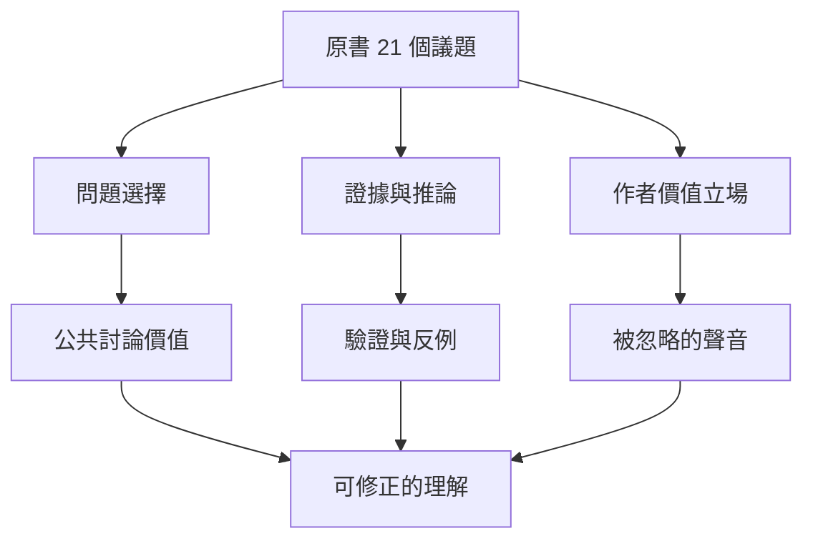

這張地圖把原書當作公共問題清單，而非不可質疑的答案。讀者需要同時保留作者擅長的跨領域提問，以及評論者提出的外推、概括、重複與概念歧義問題。

閱讀每章時，先寫出作者真正想回答的問題，再追蹤證據與推論，最後補充不同地區、學科與群體的觀點。批判不等於否定，讚賞也不等於接受全部主張。

### 概念連結
* [[《21世紀的21堂課》原書目錄與作者的問題意識]]
* [[Harari 將閱讀本書定位為公共討論的問題清單]]
* [[批評者提醒 Harari 的大歷史敘事有概括與論證缺口]]、[[書評指出本書的問題意識鮮明但部分論證重複]]
* [[未來預測應作為可修正情境而非命運]]、[[批判一本書應同時檢驗證據與提問價值]]
