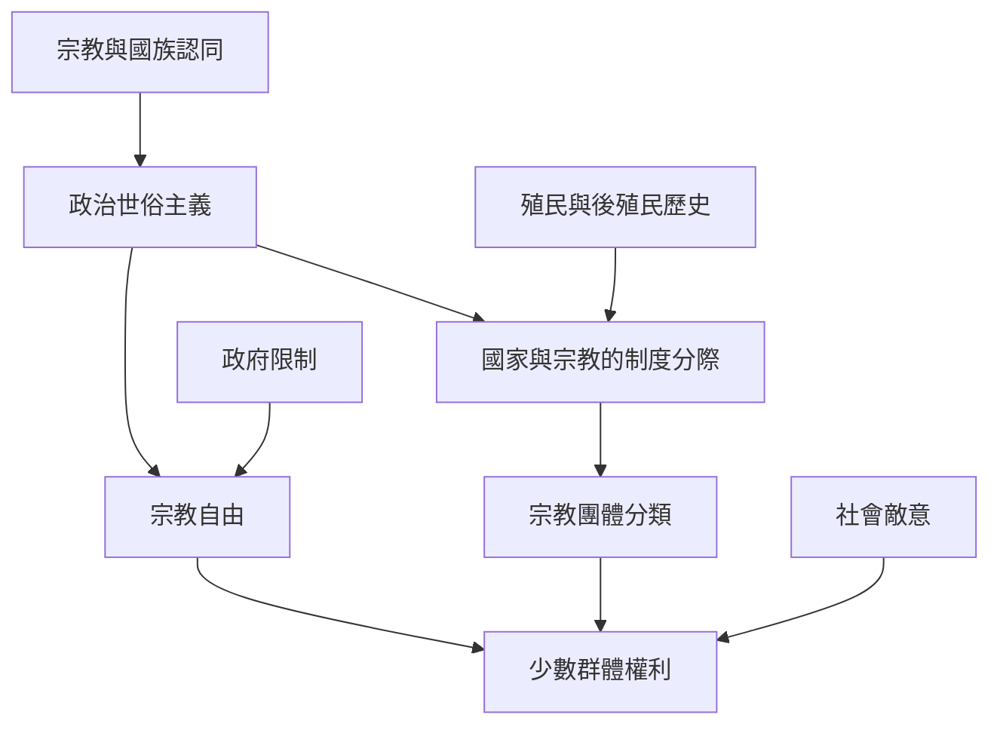

本圖將原書的宗教與世俗主義章節，與宗教自由、少數群體權利、殖民歷史及國家治理研究連結。世俗主義不等於宗教退出公共生活；關鍵是國家如何分類、管理與保障宗教差異。

可先讀 [[世俗制度不等於宗教在公共生活中消失]]，再以埃及個案和跨國宗教限制指數互相比照。避免將一種歐洲世俗化歷史視為全球共同道路。

### 概念連結
* [[世俗主義]]、[[國族主義]]、[[共同文明]]
* [[世俗制度不等於宗教在公共生活中消失]]、[[宗教差異需要檢查國家治理如何分類與保護少數群體]]
* [[比較世俗主義在不同歷史與制度脈絡中的實作]]、[[批判一本書應同時檢驗證據與提問價值]]
