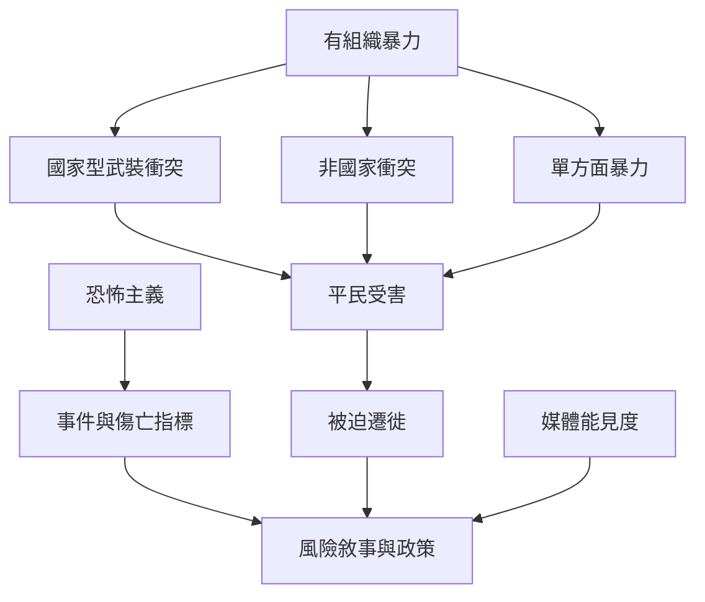

原書提醒讀者不要恐慌，也不要低估人類愚蠢；這張地圖將其轉化為一種資料閱讀方法：區分戰爭、武裝衝突、恐怖攻擊與被迫遷徙，並檢查媒體曝光、統計方法與人道後果。

閱讀順序：先讀 [[戰爭統計必須區分衝突類型與平民經驗]]，再看 [[反恐政策應區分恐怖攻擊、戰爭結構與媒體能見度]]，最後將統計與 [[UNHCR 全球趨勢報告呈現被迫遷徙的人道現實]] 對照。

### 概念連結
* [[社會韌性]]、[[全球公共財]]、[[國族主義]]
* [[戰爭統計必須區分衝突類型與平民經驗]]、[[反恐政策應區分恐怖攻擊、戰爭結構與媒體能見度]]
* [[以不同資料集交叉理解戰爭與恐怖主義風險]]
