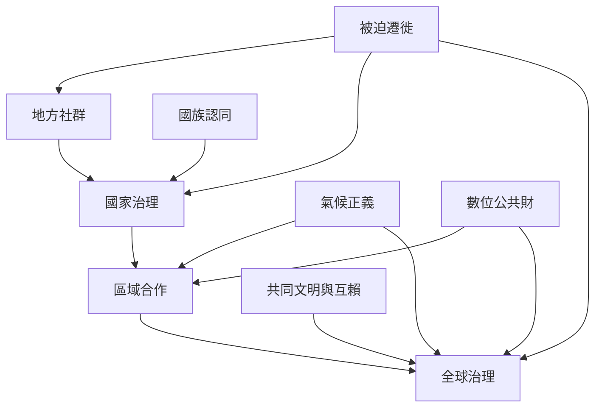

政治挑戰可以理解為不同尺度的共同體如何分配責任、資源與決策權。國家仍是權利保障與再分配的重要制度，但氣候、數位治理、移民與衝突等問題已跨越國界，需要區域及全球協作。

閱讀時避免將全球主義與國族認同視為互斥立場。重要問題是：什麼事情應由哪個層級決策？不同群體是否有平等的參與和申訴機會？

### 概念連結
* [[國族主義]]、[[共同文明]]、[[全球公共財]]、[[氣候正義]]、[[社會韌性]]
* [[國族認同與全球合作不是只能二選一]]、[[全球相互依賴不代表世界只剩單一文明]]
* [[移民議題需要同時看見權利、社區能力與歷史脈絡]]、[[氣候與科技風險的全球性需要差異化正義]]
