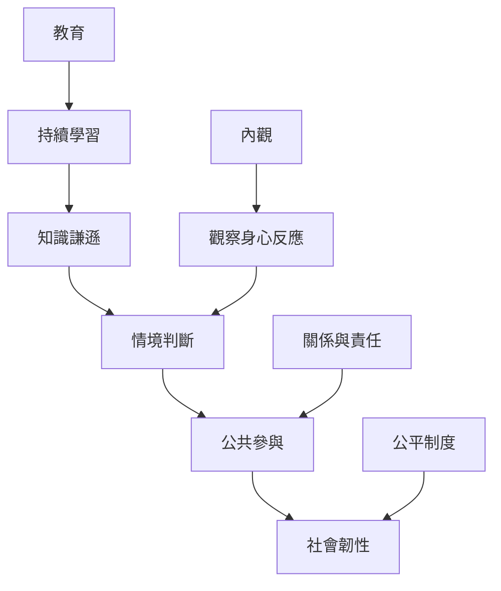

當世界不斷變動，韌性不等於忍耐一切，而是人與社群能持續觀察、學習、合作和調整。教育培養判斷與學習能力，意義提供關係與責任的方向，內觀則可支持個人辨認身心反應；這些能力都不能取代公平制度。

閱讀本地圖時，先區分個人能力與制度條件。個人可以練習觀察、學習與合作，但就業保障、公共資訊與社會公平仍需集體行動。

### 概念連結
* [[內觀]]、[[知識謙遜]]、[[社會韌性]]
* [[教育的核心是持續學習與情境判斷]]、[[生命意義不是唯一敘事而是關係與責任]]
* [[內觀能提高觀察能力但不能取代政治改革]]、[[設計一門以學會學習為核心的成人課]]
