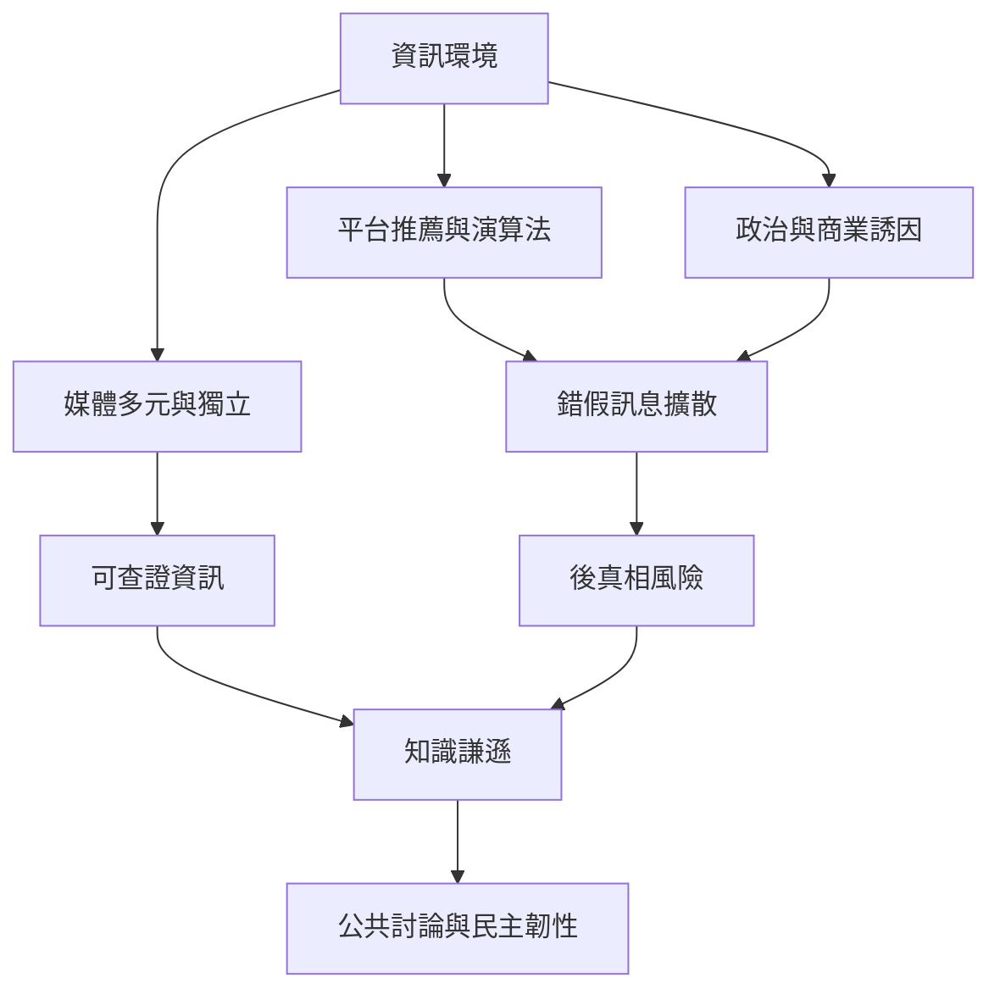

「真相」不只是個人是否找到正確答案，也涉及社會如何生產、分配、驗證與信任資訊。錯假訊息、平台推薦、媒體市場與政治權力共同構成資訊環境；因此，個人查核能力與制度層面的資訊完整性必須並行。

建議先讀 [[資訊完整性取決於媒體生態而非單純事實查核]]，再讀 [[知識謙遜是資訊過量時的公共能力]]；把每次判斷都視為可以更新的知識狀態。

### 概念連結
* [[資訊完整性]]、[[錯假訊息]]、[[後真相]]、[[知識謙遜]]、[[演算法治理]]
* [[批判一本書應同時檢驗證據與提問價值]]
* [[建立跨立場資訊查證小組]]、[[把靜觀練習與媒體消費前後的注意力記錄結合]]
