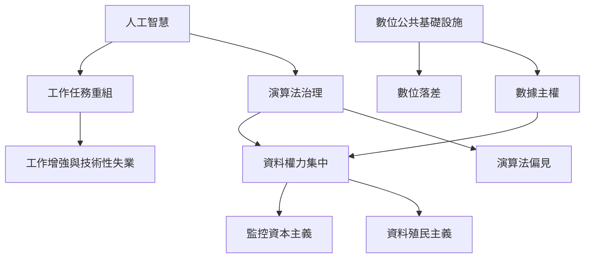

科技挑戰不只是機器是否比人類更聰明，而是工作任務、資料權力、基礎設施與收益分配如何改變。這張地圖把原書「工作、自由、平等」與當代 AI 治理材料連起來。

閱讀順序可先從 [[自動化改變的是任務組合而非單一職業的存亡]] 開始，再讀 [[數據治理決定誰能看見並影響人的行動]]，最後以 [[數位權力也需要反殖民的資料觀]] 檢查全球南北權力差異。

### 概念連結
* [[AI 人工智慧]]、[[演算法治理]]、[[演算法偏見]]、[[資料殖民主義]]、[[監控資本主義]]
* [[工作增強]]、[[技術性失業]]、[[數位落差]]、[[數位公共基礎設施]]、[[數據主權]]
* [[技術轉型成本取決於社會安全網與勞動談判]]、[[演算法公平必須追問制度如何定義問題]]
