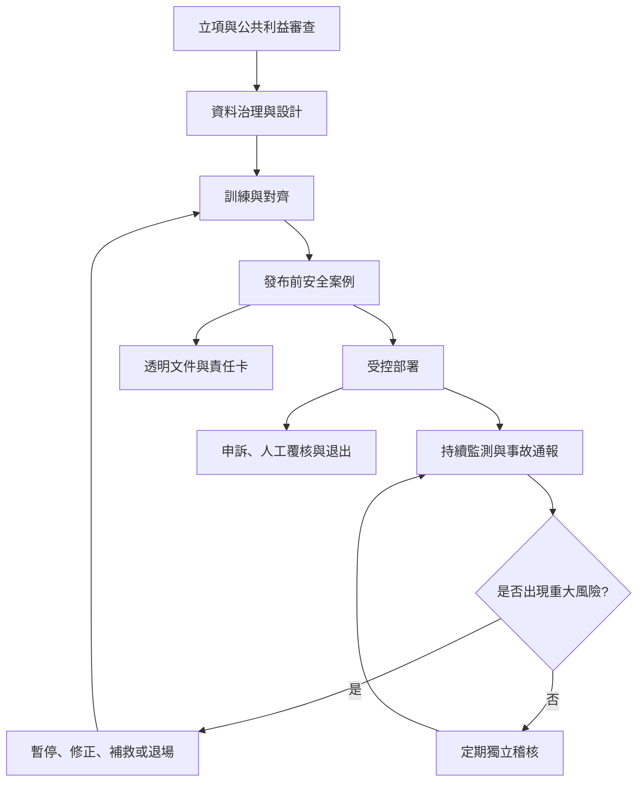

安全不是一次測驗通過就完成，而是將主張、證據、責任與補救貫穿模型生命週期。此圖從立項到退場，呈現技術評估與制度治理如何互相提供回饋。

[[AI對齊必須覆蓋模型生命週期而非只做訓練]] · [[AI安全的證據應公開限制假設與未解決問題]] · [[公共利益對齊需要可拒絕可退出與可申訴的制度設計]] · [[國際原則必須轉化為可稽核的責任]] · [[風險管理]] · [[AI治理]] · [[可修正性]] · [[AI_alignment]]
