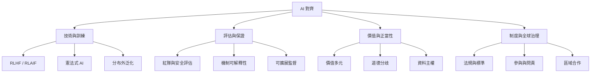

AI 對齊由多個研究方向交會而成。技術方法塑造模型行為，評估方法提供可靠性證據，價值與政治理論處理誰的目標被代表，治理制度則決定權力與責任如何安排。以下地圖用來定位問題，不代表所有方法都能互相替代。

[[AI對齊至少包含技術行為價值與制度四個層次]] · [[人類回饋是代理訊號而非普世價值]] · [[價值多元不是讓模型同時說出所有立場而已]] · [[AI對齊必須覆蓋模型生命週期而非只做訓練]] · [[人工智慧對齊]] · [[人工智慧安全]] · [[AI治理]] · [[AI_alignment]]

## 參考
* 綜述：[AI Alignment: A Contemporary Survey](https://doi.org/10.1145/3770749)。
