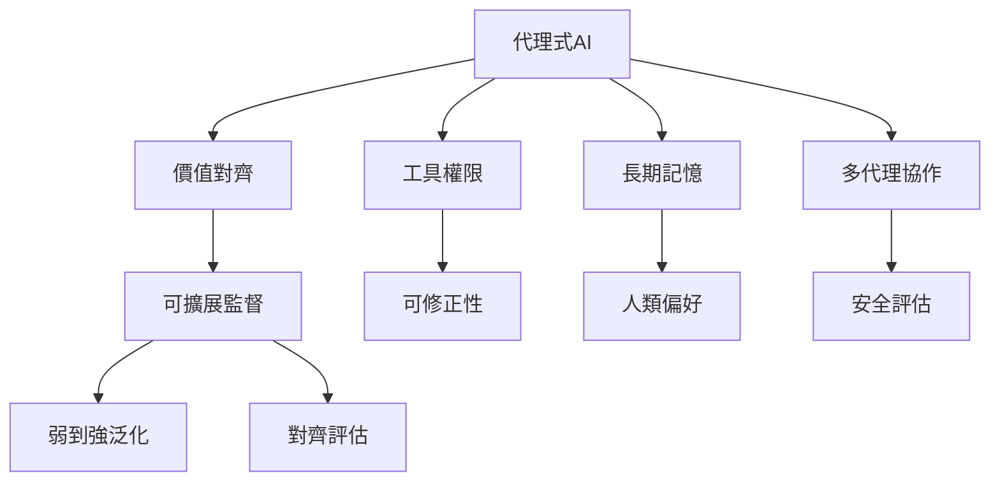

代理式系統把模型輸出接到工具、記憶與多代理網絡，讓安全問題從「說了什麼」變成「採取了什麼行動、影響了誰」。此地圖把代理權限、長期狀態、監督能力與安全評估串在一起。

核心概念：[[代理式AI]]、[[多代理協作]]、[[可擴展監督]]、[[弱到強泛化]]、[[對齊評估]]、[[可修正性]]、[[AI安全]]。

延伸筆記：[[代理式AI的價值對齊必須跨越模型代理與多代理層次]]、[[長期記憶會讓價值對齊成為持續治理問題]]、[[工具權限應依風險與可逆性逐步授予]]、[[可擴展監督不是增加標註數量而已]]。
