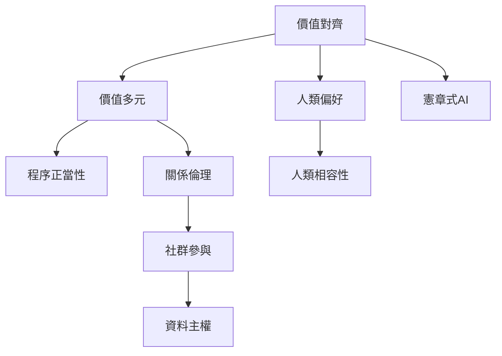

價值對齊的難題在於價值不是單一、固定且可直接量測的數值。此地圖把偏好推論、價值多元、關係倫理與程序正當性連起來，協助讀者從技術資料走向規範選擇。

核心概念：[[價值對齊]]、[[價值多元]]、[[程序正當性]]、[[關係倫理]]、[[資料主權]]、[[CARE原則]]、[[憲章式AI]]、[[可修正性]]。

延伸筆記：[[人類偏好只是價值的局部證據]]、[[價值對齊必須區分指令偏好利益與價值]]、[[價值多元要求可爭議而非假裝一致的治理程序]]、[[關係倫理讓對齊的單位從個人擴展到社群]]。
