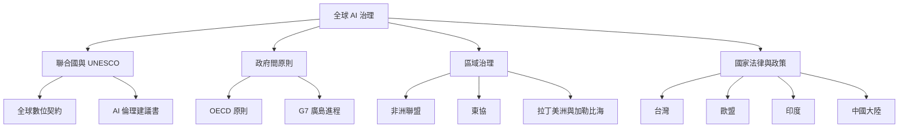

國際治理需要共同安全底線與跨境互通，也需要尊重各地法律制度、語言文化與發展優先序。這張地圖把全球與區域文件放在同一脈絡下，提醒比較時必須辨識它們的法律效力與參與代表性。

[[國際對齊需要互通治理但不應消除地方差異]] · [[多元對齊必須觸及資源與權力分配]] · [[台灣的AI治理應把原則落實到社區與公共服務]] · [[全球數位契約要求AI治理納入發展中國家平等代表]] · [[AI治理]] · [[AI_alignment]]
