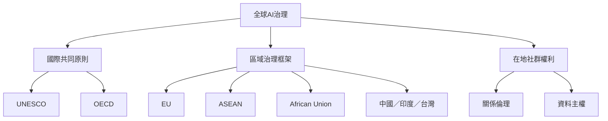

全球視角不是簡單羅列國家政策，而是檢查不同地區如何定義公共利益、分配技術能力與保障文化權利。此地圖同時納入國際共同原則、地區治理框架與在地社群的資料自主。

核心概念：[[AI治理]]、[[價值多元]]、[[關係倫理]]、[[資料主權]]、[[CARE原則]]、[[演算法殖民主義]]。

延伸筆記：[[全球對齊需要跨文化協商與制度互通]]、[[不同地區的治理框架反映不同的公共目標]]、[[國家自主能力與跨境互通必須同時討論]]、[[多語言公平必須檢查語料代表性與錯誤成本]]。
