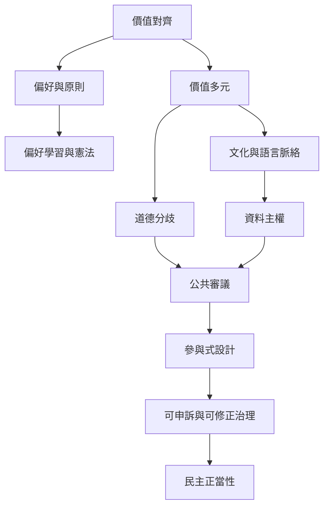

價值對齊的關鍵不是找出一個抽象的「人類價值」，而是建立能夠處理分歧、權力差異與社群權利的程序。這張地圖把偏好學習、價值多元、參與式設計、資料主權與民主正當性連接起來。

[[人類回饋是代理訊號而非普世價值]] · [[價值衝突需要正當程序而不是單一偏好分數]] · [[語言與資料主權是對齊問題而非在地化裝飾]] · [[公共利益對齊需要可拒絕可退出與可申訴的制度設計]] · [[價值對齊]] · [[價值多元]] · [[民主正當性]] · [[參與式設計]] · [[資料主權]] · [[AI_alignment]]
