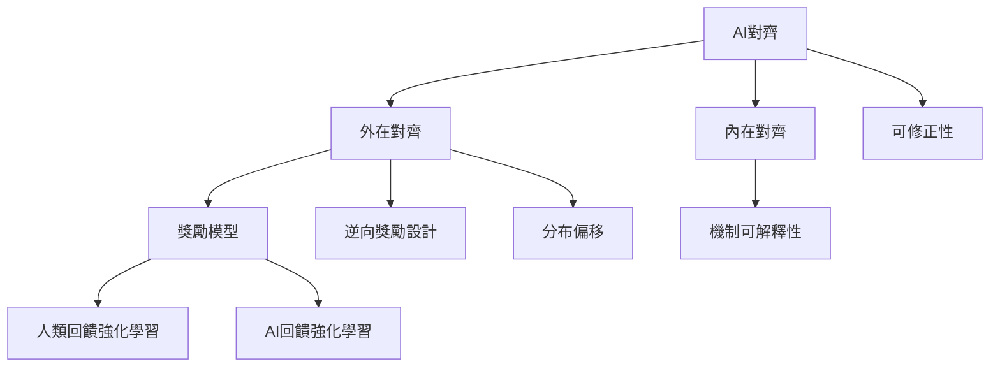

技術對齊處理目標規格、訓練回饋、模型內部機制與部署行為之間的落差。閱讀時應把「怎麼訓練」與「怎麼證明安全」分開，再檢查兩者如何互補。

核心概念：[[AI對齊]]、[[外在對齊]]、[[內在對齊]]、[[獎勵模型]]、[[人類回饋強化學習]]、[[AI回饋強化學習]]、[[逆向強化學習]]、[[合作式逆向強化學習]]、[[逆向獎勵設計]]、[[獎勵駭客]]、[[規格遊戲]]、[[分布偏移]]、[[機制可解釋性]]、[[可修正性]]。

延伸筆記：[[獎勵函數只是意圖的代理指標而不是意圖本身]]、[[外在對齊與內在對齊是不同的失敗來源]]、[[安全評估必須同時測量行為與內部機制]]、[[可解釋性不能單獨證明模型安全]]。
