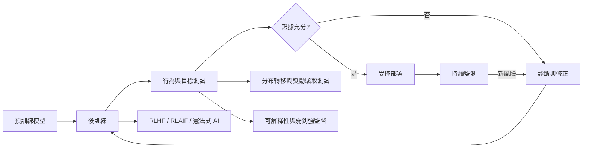

技術對齊可以理解為「訓練—泛化—監督—檢驗」的循環。訓練方法改變模型行為；分布外測試檢查行為是否穩健；可解釋性與監督方法提供額外證據；紅隊測試則嘗試推翻安全主張。

[[穩健對齊必須測試目標而不只測試能力]] · [[代理指標愈容易被最佳化愈需要反向測試]] · [[可解釋性提供線索但不是安全證書]] · [[監督者能力不足需要分層驗證與升級流程]] · [[人工智慧安全]] · [[人類回饋強化學習]] · [[機制可解釋性]] · [[可擴展監督]] · [[獎勵駭取]] · [[AI_alignment]]
