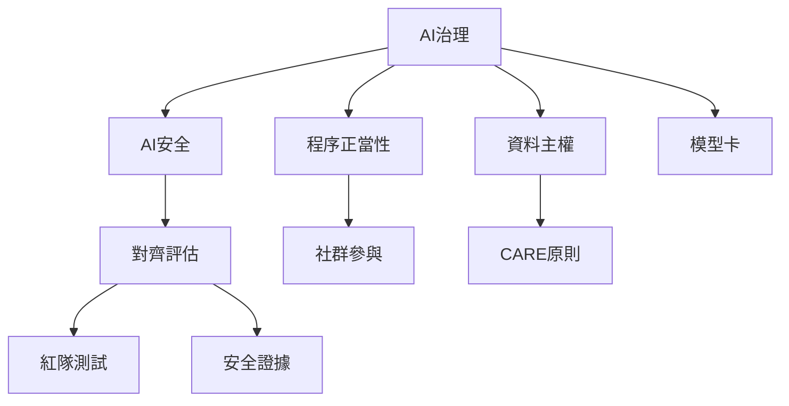

治理把價值原則轉化為制度責任、風險程序與救濟路徑。此地圖強調法規、標準與組織實踐之間的差異，也提醒治理不能只依靠企業自律或模型拒答。

核心概念：[[AI治理]]、[[AI安全]]、[[程序正當性]]、[[模型卡]]、[[紅隊測試]]、[[對齊評估]]、[[資料主權]]、[[CARE原則]]。

延伸筆記：[[法律原則必須轉化為可追責的部署義務]]、[[不同地區的治理框架反映不同的公共目標]]、[[治理制度決定誰能定義可接受的AI風險]]、[[模型對齊不能取代資料與基礎設施責任]]。
