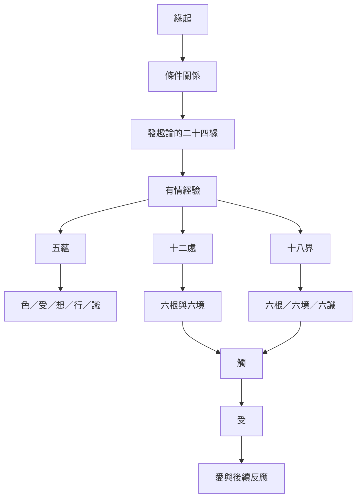

阿毘達磨藉由不同分類架構觀察經驗，也透過因果與條件理論說明法如何相互依存。五蘊、十二處與十八界不是三種互斥宇宙，而是從不同角度分析經驗的框架；上座部《發趣論》則以二十四緣深入討論條件關係。

相關筆記：[[法的分析尺度會改變我們理解經驗的方式]]、[[說一切有部以三世實有論處理法的時間存在問題]]、[[因果條件表能避免把修行簡化成單因單果]]。

概念：[[五蘊（Skandha／Khandha）]]、[[十二處（Āyatana）]]、[[十八界（Dhātu）]]、[[緣起（Pratītyasamutpāda）]]、[[條件關係（Paccaya）]]、[[發趣論（Paṭṭhāna）]]
