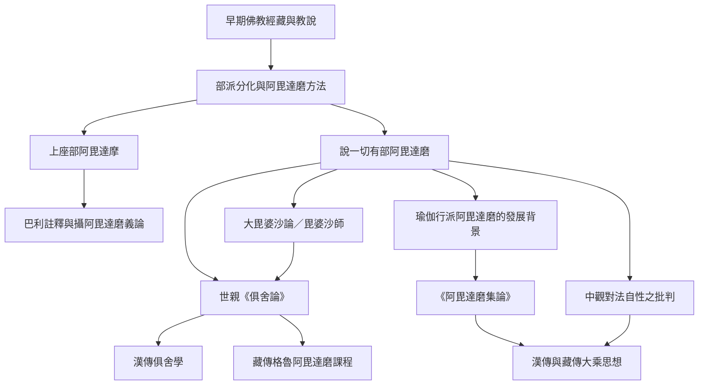

阿毘達磨從印度早期部派的分類與論辯展開，形成上座部與說一切有部兩個保存完整的主要系統，之後由《俱舍論》、瑜伽行派、中觀、漢傳與藏傳學術傳承持續轉化。這張圖以文本傳承和思想回應為主，不把所有支線畫成單向、無爭議的直線。

相關筆記：[[不同部派的阿毘達磨不能合併成單一體系]]、[[《俱舍論》保存並批判說一切有部的論點]]、[[瑜伽行派延續阿毘達磨形式並重構其心識理論]]、[[中觀將阿毘達磨法的自性納入空性分析]]。

概念：[[阿毘達磨（Abhidharma／Abhidhamma）]]、[[上座部（Theravāda）]]、[[說一切有部（Sarvāstivāda）]]、[[俱舍論（Abhidharmakośa）]]、[[瑜伽行派（Yogācāra）]]、[[中觀（Madhyamaka）]]
