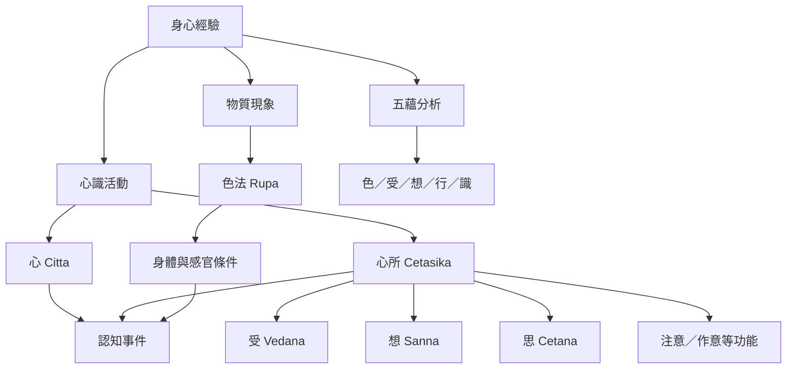

阿毘達磨的心識分析不是單純把心理經驗分成正面與負面，而是嘗試說明認知事件由哪些功能構成，以及身心現象如何被分類。以下以南傳後期教學常見的心、心所、色法分類為一個示意模型，並提醒讀者不同部派不共享同一套分類表。

相關筆記：[[上座部阿毘達摩以心與心所分析心理事件]]、[[法的分析尺度會改變我們理解經驗的方式]]、[[心與心所的共同生起是一種事件分析模型]]。

概念：[[心（Citta）]]、[[心所（Cetasika）]]、[[色法（Rūpa）]]、[[受（Vedanā）]]、[[想（Saṃjñā／Saññā）]]、[[思（Cetanā）]]、[[五蘊（Skandha／Khandha）]]、[[識（Vijñāna／Viññāṇa）]]
