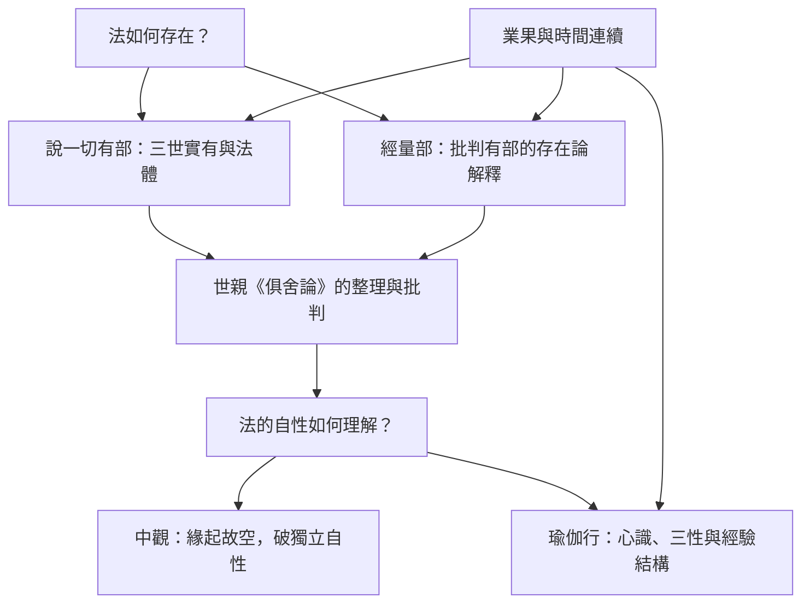

阿毘達磨不只分類身心，也面對「法究竟如何存在」「過去與未來的法是否存在」「法是否有自性」「心識如何保持連續」等哲學問題。這張圖將說一切有部、經量部、世親、中觀與瑜伽行派的論辯方向並列，呈現不同問題意識。

相關筆記：[[說一切有部以三世實有論處理法的時間存在問題]]、[[《俱舍論》保存並批判說一切有部的論點]]、[[中觀將阿毘達磨法的自性納入空性分析]]、[[瑜伽行派延續阿毘達磨形式並重構其心識理論]]。

概念：[[自性（Svabhāva）]]、[[空性（Śūnyatā）]]、[[剎那（Kṣaṇa）]]、[[說一切有部（Sarvāstivāda）]]、[[經量部（Sautrāntika）]]、[[俱舍論（Abhidharmakośa）]]、[[阿賴耶識（Ālayavijñāna）]]
