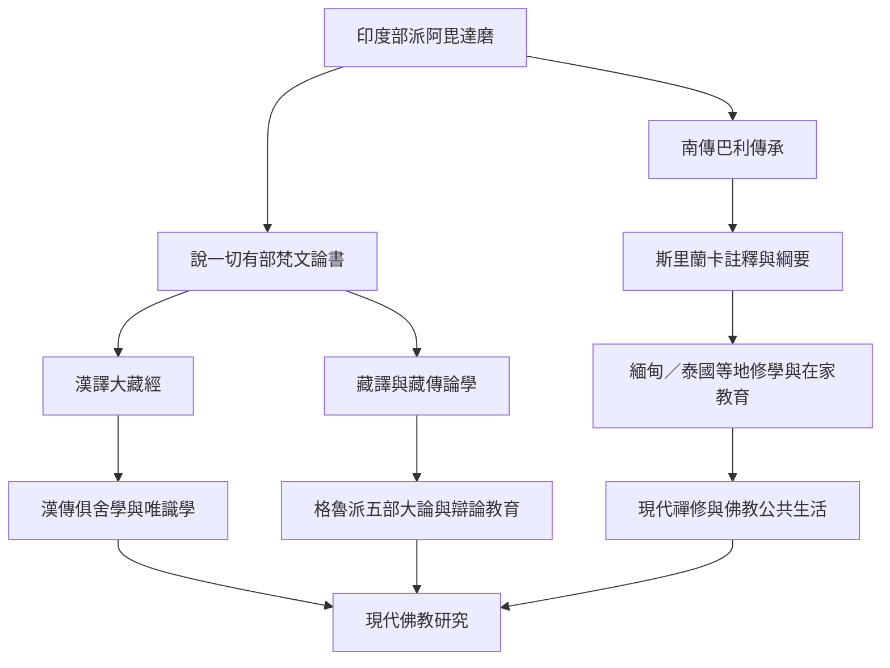

阿毘達磨在不同地區的知識形式各異：斯里蘭卡與東南亞的巴利傳承、緬甸在家阿毘達摩教育、漢譯大藏經保存的說一切有部論書，以及藏傳格魯僧院的俱舍辯論課程。這些路徑構成互相交疊但不能互相取代的傳播史。

相關筆記：[[阿毘達磨在緬甸也成為在家教育與宗教公共生活的一部分]]、[[藏傳格魯僧院把阿毘達磨納入長期辯論教育]]、[[漢譯保存使說一切有部論書成為東亞佛教思想資源]]。

概念：[[上座部（Theravāda）]]、[[說一切有部（Sarvāstivāda）]]、[[俱舍論（Abhidharmakośa）]]、[[阿毘達磨藏（Abhidharma Piṭaka）]]
