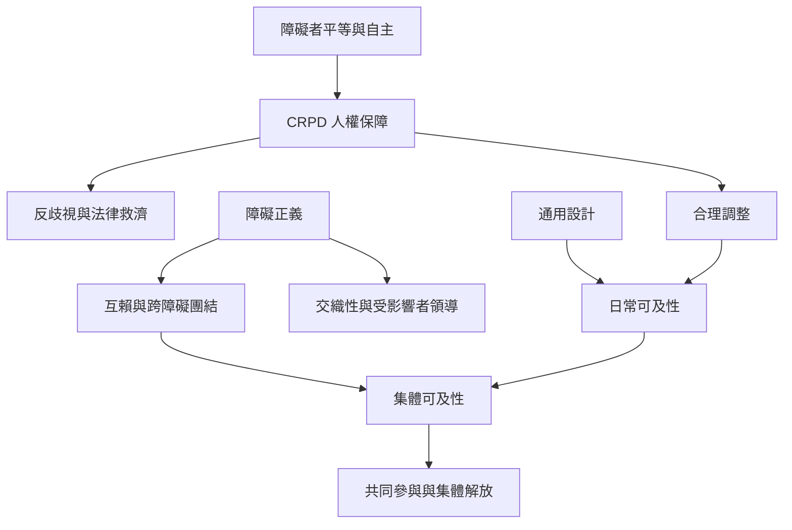

反能力主義的實踐不是單一政策，而是從權利保障、環境設計、個別調整到集體照護的組合。CRPD 提供法律基礎；合理調整回應個別需求；通用設計預先降低障礙；障礙正義則把參與與照護轉成集體責任。

## 思與行
* 由具體生活場景開始，找出需要通用設計、合理調整或制度改革的地方。
* 把障礙者納入決策、預算與評估，並建立可以持續追蹤的回饋機制。

## 參考
* [[國際人權法將障礙歧視連結到平等參與與環境障礙]]；[[聯合國一般性意見第六號要求從慈善模式轉向平等與反歧視]]；[[障礙正義以交織性互賴與集體可及性擴大權利政治]]；[[合理調整是可執行的平等義務而非額外恩惠]]；[[通用設計應減少每個人逐一請求調整的負擔]]；[[集體可及性把參與條件變成所有成員共同承擔的責任]]；[[互賴不是自主的反面而是生活的條件]]；[[法律承諾必須經過預算與地方執行才會成為可經驗的權利]]。
* 概念：[[身心障礙者權利公約（CRPD）]]、[[合理調整（Reasonable Accommodation）]]、[[通用設計（Universal Design）]]、[[集體可及性（Collective Access）]]、[[互賴（Interdependence）]]、[[障礙正義（Disability Justice）]]。
