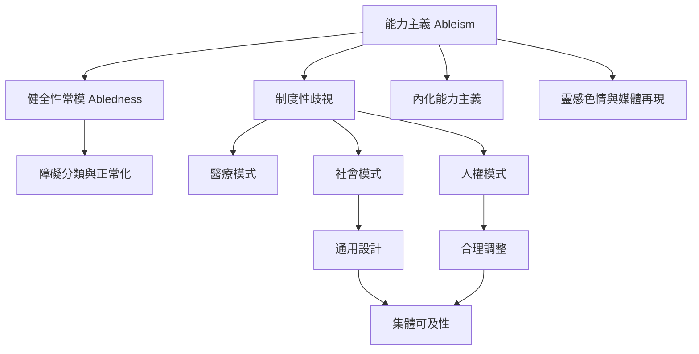

能力主義研究的主軸，是理解「正常能力」如何被建構，以及這套常模如何透過制度、互動與自我評價生產排除。從概念上，可由能力主義連到健全性、障礙、障礙研究、醫療／社會／人權模式，再連到內化能力主義與靈感色情等文化機制。

## 思與行
* 閱讀時先問「標準能力是誰定義的」，再問「這個標準如何進入制度」。
* 用社會模式分析環境，用人權模式確認義務，再用具身經驗校正理論。

## 參考
* [[能力主義的核心不只是排斥障礙者而是生產健全常態]]；[[能力常模先於個人偏見而形塑制度]]；[[健全性不是中立背景而是一種被生產的社會標準]]；[[制度性排除可以在沒有惡意的情況下持續發生]]；[[內化能力主義會讓人用主流標準評價自己與同儕]]；[[醫療模式把問題集中在個人而可能遮蔽制度責任]]；[[社會模式把障礙從個人缺陷轉向社會造成的限制]]；[[人權模式把障礙者定位為有自主權的權利主體]]；[[障礙語言應尊重社群偏好而非強迫單一正確稱呼]]。
* 概念：[[能力主義（Ableism）]]、[[障礙（Disability）]]、[[健全性（Abledness）]]、[[障礙研究（Disability Studies）]]、[[醫療模式（Medical Model of Disability）]]、[[社會模式（Social Model of Disability）]]、[[人權模式（Human Rights Model of Disability）]]、[[內化能力主義（Internalized Ableism）]]、[[靈感色情（Inspiration Porn）]]。
