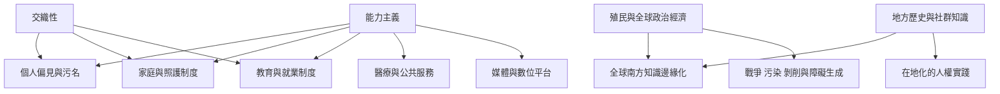

這張地圖從權力層次整理能力主義：個人互動中的刻板印象、家庭與機構中的安排、勞動與教育中的制度規格，以及殖民和全球政治經濟。交織性與地方知識能避免把障礙者經驗想成單一而普遍。

## 思與行
* 分析政策與研究時同時標記地理區域、作者位置、障礙類型及交織身份。
* 避免把「全球南方」當成單一文化，也不要把全球北方理論當成無需翻譯的普遍模型。

## 參考
* [[亞洲跨十七個國家地區的研究顯示能力主義存在於家庭制度與社會]]；[[職場能力主義透過招募揭露與合理調整影響就業]]；[[醫療專業內的能力主義同時存在於環境與人際層次]]；[[去殖民障礙研究要求全球南方經驗不再只是北方理論的例證]]；[[全球南方障礙人類學提醒研究者不要把身心差異化約成單一分類]]；[[印度障礙正義研究把種姓階級性別與照護未來放在同一分析框架]]；[[中國障礙者線上行動研究揭示明示標籤與內化刻板印象共同作用]]；[[非洲多國 CRPD 實作研究凸顯權利承諾與地方落差]]；[[台灣 CRPD 第三次國家報告與民間監督材料提供政策檢視入口]]。
* 概念：[[交織性（Intersectionality）]]、[[聽人中心主義（Audism）]]、[[精神障礙污名（Sanism）]]、[[神經多樣性（Neurodiversity）]]、[[優生學（Eugenics）]]。
