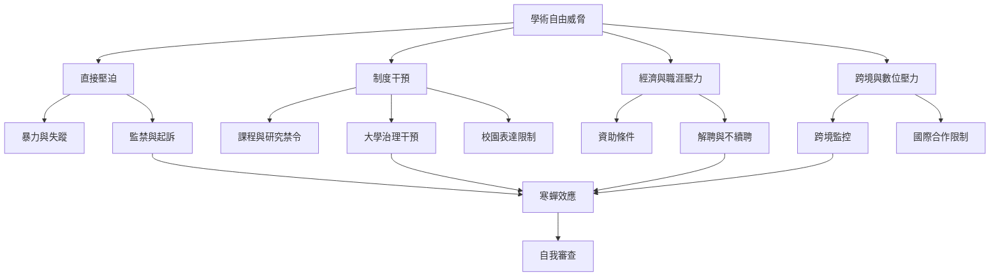

學術自由威脅不只來自直接審查，也可能由法律、行政、資助、監控、聘任與校園空間控制逐步形成。威脅彼此會互相放大，最後造成寒蟬效應與自我審查。

## Mermaid 關係圖

## 概念連結
[[寒蟬效應]]、[[自我審查]]、[[研究安全]]、[[校園完整性]]、[[聘任穩定]]、[[研究自由]]、[[自由結社]]。

## 延伸閱讀
* [[自我審查是制度壓力長期累積後的寒蟬效應]]
* [[行政與法規可以在沒有直接審查時削弱學術自治]]
* [[跨境監控使學術自由超出校園與國界的範圍]]

參考全書：[[Academic_freedom]]。
