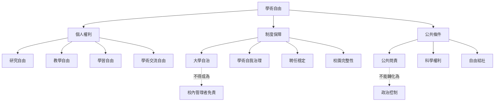

學術自由的核心架構包含個人層次、組織層次與公共層次。個人研究、教學與學習權利，需要學術共同體自治及大學制度支撐；而大學自治又必須接受透明的公共問責，並保障校內成員。

## Mermaid 關係圖

## 概念連結
[[學術自由]]、[[大學自治]]、[[研究自由]]、[[教學自由]]、[[學習自由]]、[[學術交流自由]]、[[學術自我治理]]、[[終身職]]、[[公共問責]]、[[科學權利]]、[[自由結社]]。

## 延伸閱讀
* [[學術自由是個人權利與學術共同體制度共同構成的生態系]]
* [[大學自治是學術自由的制度條件但不是管理者的免責特權]]
* [[學術自由需要公共問責而不是政治控制]]

參考全書：[[Academic_freedom]]。
