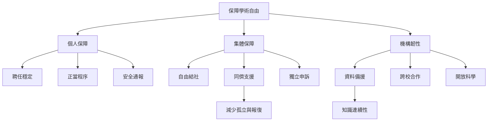

保護學術自由不能只靠宣示原則，而需要具體制度：公平聘任、透明研究契約、獨立申訴、學術結社、校園安全與研究資料備援。這些保障要能在危機發生前運作。

## Mermaid 關係圖

## 概念連結
[[聘任穩定]]、[[正當程序]]、[[自由結社]]、[[同行評議]]、[[開放科學]]、[[研究倫理]]、[[研究安全]]。

## 延伸閱讀
* [[每所大學都可以公開一份學術自由韌性檢核報告]]
* [[校園可以建立保護異議者的安全通報與同儕支援網絡]]
* [[跨校支持網絡可以讓遭威脅學者保留研究與教學連續性]]

參考全書：[[Academic_freedom]]。
