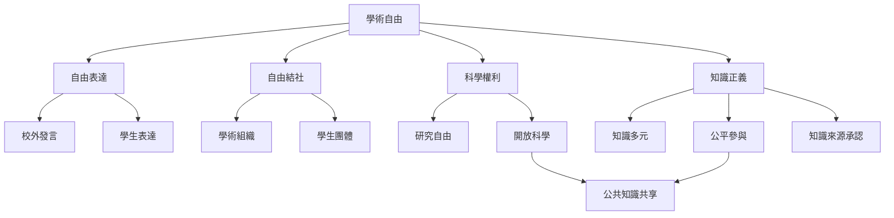

學術自由與言論、集會、結社、教育及科學權利相互依存。知識制度的公平性也取決於誰能參與研究、哪些知識被承認，以及學術成果如何回到社會。

## Mermaid 關係圖

## 概念連結
[[學術自由]]、[[學生表達]]、[[自由結社]]、[[科學權利]]、[[開放科學]]、[[知識正義]]、[[學術責任]]、[[校外發言]]。

## 延伸閱讀
* [[學術自由是科學權利與知識公共性的制度條件]]
* [[學術自由需要公平參與而不應固化既有知識階序]]
* [[自由表達與免於歧視及暴力必須共同保障]]

參考全書：[[Academic_freedom]]。
