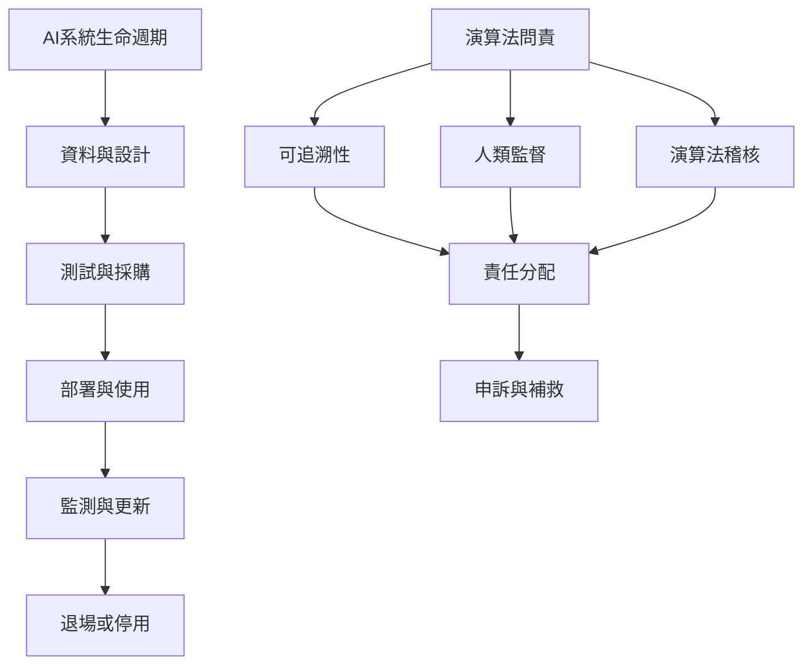

AI 系統的責任分散在資料、模型、部署、採購與使用等角色之間。問責需要可追溯性、風險評估、適當人工監督、外部稽核、申訴與補救，並隨系統生命週期持續更新。

概念入口：[[演算法問責]]、[[可追溯性]]、[[人類監督]]、[[責任分配]]、[[稽核]]、[[補救]]、[[利害關係人]]。

研究依據：[[AI問責必須覆蓋生命週期並讓系統可追溯與可審查]]、[[OECD更新AI原則後把問責連結到角色分工與全生命週期追蹤]]。

延伸實踐：[[為高影響AI建立可理解的問責登錄與申訴路徑]]、[[用責任矩陣與受害者視角共同檢查跨組織責任空隙]]。
