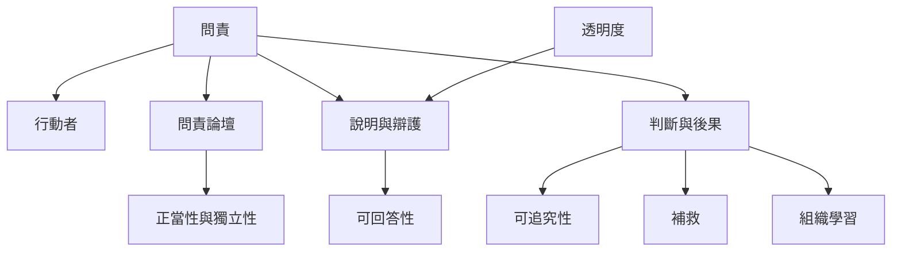

本圖整理問責的核心結構：問責不是抽象的責任感，而是特定行動者對特定論壇負有說明義務，並接受提問、判斷、後果與補救。透明提供資訊基礎，可回答性提供說明過程，可追究性提供判斷及行動能力。

概念入口：[[問責]]、[[可回答性]]、[[可追究性]]、[[問責論壇]]、[[透明度]]、[[補救]]、[[正當程序]]、[[比例原則]]。

核心論證：[[問責是一種關係制度而不是個人美德]]、[[問責需要可追究性也需要可回答性]]、[[透明是問責的條件卻不是問責本身]]、[[問責論壇必須有正當性能力與獨立性]]。

實作延伸：[[為每個公共決策建立一張可追蹤的問責關係卡]]、[[建立一份問責成熟度自我檢視而不是單純合規評分]]。
