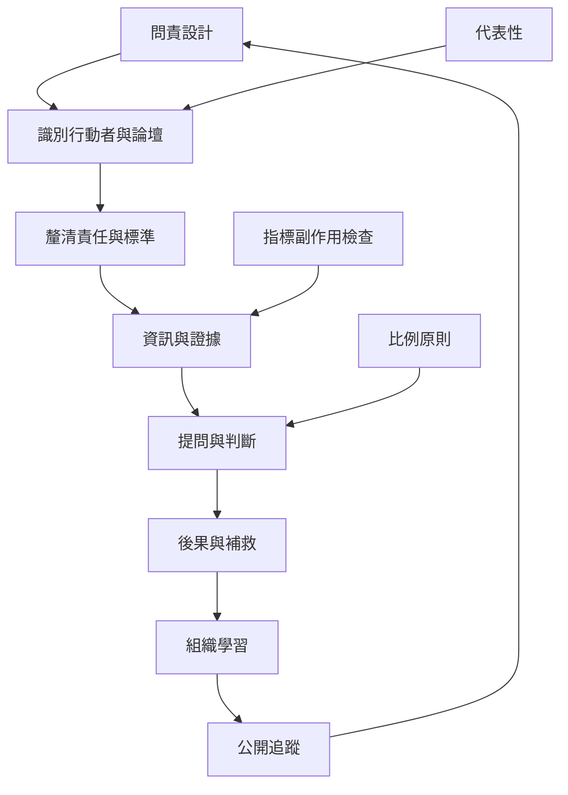

問責制度的設計不是增加表格，而是把權力、資訊、參與、判斷、補救與學習連成有效循環。制度需要在透明與隱私、制裁與學習、效率與參與、量化與脈絡之間取得平衡。

概念入口：[[問責]]、[[問責論壇]]、[[責任分配]]、[[透明度]]、[[正當程序]]、[[比例原則]]、[[組織學習]]、[[補救]]。

實作卡：[[為每個公共決策建立一張可追蹤的問責關係卡]]、[[把問責設計成發聲回覆改善再回報的閉環]]、[[讓績效指標附帶一份被忽略價值與副作用清單]]、[[把重大錯誤檢討分成責任釐清補救與學習三條線]]、[[建立一份問責成熟度自我檢視而不是單純合規評分]]。

批判提醒：[[問責指標可能讓組織優先製造可驗證證據]]、[[問責需要比例原則以免製造防衛性行政]]、[[問責可以建立在關係照顧與共同創造而不只監督制裁]]。
