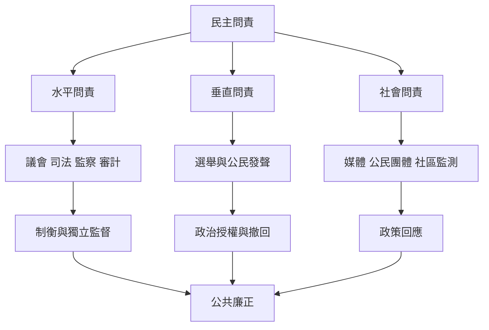

民主問責透過不同制度層次限制公共權力。選舉與公民社會形成垂直監督；議會、司法、監察及審計機關形成水平制衡；公共廉正、媒體自由與開放政府提供制度環境。沒有獨立監督能力，法律上的制衡可能只是形式。

概念入口：[[民主問責]]、[[公共問責]]、[[垂直問責]]、[[水平問責]]、[[社會問責]]、[[公共廉正]]、[[開放政府]]、[[政策回應]]。

研究依據：[[新興民主需要讓國家機關彼此制衡而不只依賴選舉]]、[[臺灣開放政府方案把透明課責與參與列為治理核心]]。

延伸問題：[[垂直問責與水平問責需要共同維持民主]]、[[把問責設計成發聲回覆改善再回報的閉環]]。
