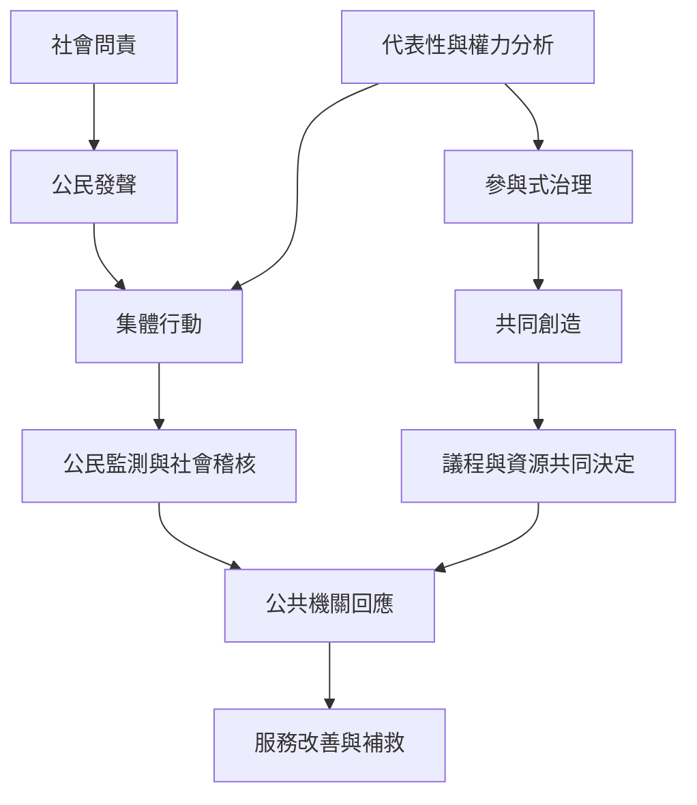

社會問責將個人經驗轉化為公共要求，並讓公民參與監督公共服務與決策。其有效性需要公民發聲、集體行動、資訊可近性與政府回應能力；參與制度則必須處理代表性、資源差異及議程控制，不能把出席人數當作民主成果。

概念入口：[[社會問責]]、[[公民發聲]]、[[集體行動]]、[[參與式治理]]、[[共同創造]]、[[代表性]]、[[權力不對等]]、[[社會稽核]]、[[公民評分卡]]。

案例與研究：[[公民發聲必須連結集體行動與政府回應能力才可能產生問責]]、[[烏干達社區監測研究顯示居民參與能改變基層醫療服務]]、[[印度班加羅爾公民評分卡把服務使用者經驗帶入公共討論]]、[[巴西參與式預算顯示參與問責也可能重製權力差距]]。

延伸實踐：[[把問責設計成發聲回覆改善再回報的閉環]]、[[為參與式會議設計代表性與議程權的檢查清單]]。
