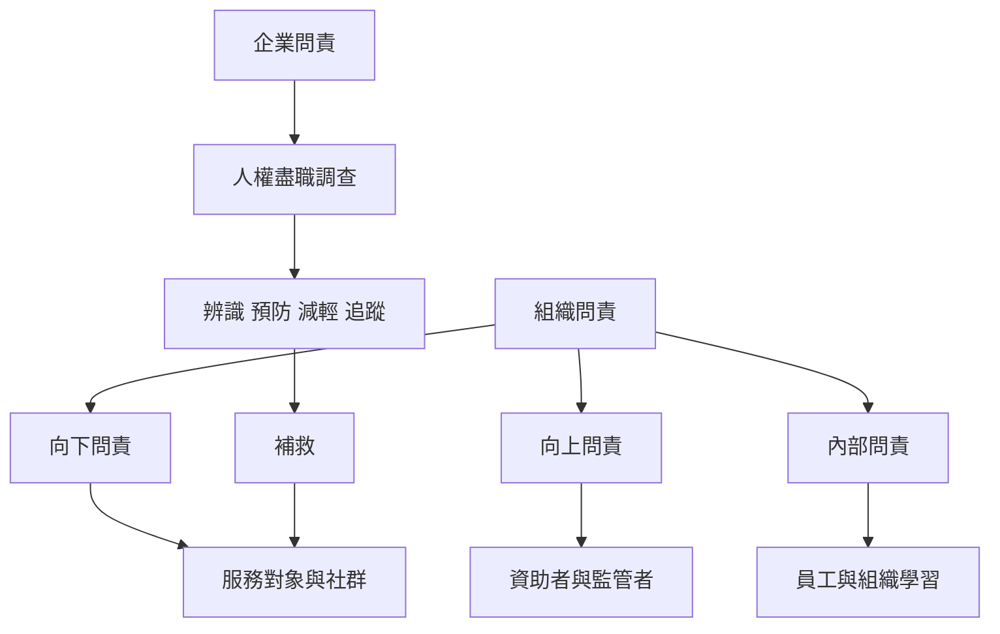

組織問責具有多個方向：向上對資助者、主管機關及董事會負責；向下對服務對象、員工與社群負責；內部問責則關係到組織文化與學習。企業與人權問責進一步要求辨識營運及供應鏈影響，並為受害者提供有效補救。

概念入口：[[向上問責]]、[[向下問責]]、[[利害關係人]]、[[企業問責]]、[[人權盡職調查]]、[[供應鏈責任]]、[[補救]]、[[組織學習]]。

研究依據：[[非營利組織容易優先向捐助者負責而忽略服務對象]]、[[企業人權責任必須連結國家保護與受害者有效救濟]]。

延伸實踐：[[替公益組織設計由服務對象共同治理的回饋制度]]、[[用責任矩陣與受害者視角共同檢查跨組織責任空隙]]。
