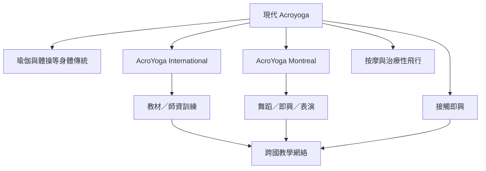

Acroyoga 的現代發展可從多條相互交會的線索理解：蒙特婁的舞蹈與特技融合、美國 AcroYoga International 的系統化教學，以及更廣泛的瑜伽、體操、接觸即興、按摩與社群特技實踐。名稱和商標不等於完整歷史，教材與認證也只是傳承方式之一。

## 概念
* [[term/Acroyoga 是結合瑜伽意識與夥伴特技的身體實踐]]
* [[term/AcroYoga Montreal 是以舞蹈與特技融合發展的 Acroyoga 路線]]
* [[term/AcroYoga International 是以課程系統與師資訓練傳播的 Acroyoga 路線]]
* [[term/接觸即興是以身體接觸與即時回應共同生成動作的舞蹈形式]]
* [[term/泰式按摩是以按壓伸展與節奏性動作進行的傳統身體工作]]
* [[term/治療性飛行是以被支撐者的放鬆與伸展為主的練習形式]]

## 永久筆記
* [[note/Acroyoga 的歷史應以多條系譜而非單一創始神話來理解]]
* [[note/正式師資訓練與開放式 Jam 應形成互補而非彼此取代]]

## 文獻
* [[data/AcroYoga Montreal 的起源敘事把舞蹈特技與瑜伽融合追溯至 1998–2003]]
* [[data/AcroYoga Montreal 承認技藝源於集體演化而非單一創作者]]
* [[data/AcroYoga International 將三元素方法與師資訓練制度化]]
* [[data/Move Connect Play 將 AcroYoga 歸納為動作連結與遊戲]]
