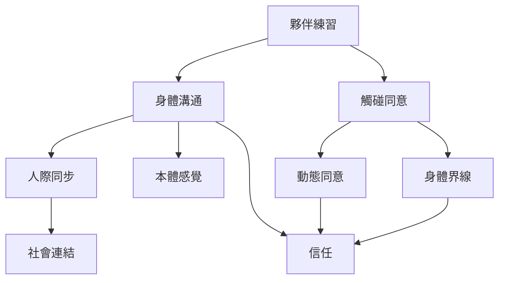

Acroyoga 的互動不只是力量傳遞，也是透過觸碰、呼吸、身體張力和語言持續協調。此圖將同意、身體界線、身體溝通與人際同步放在同一個關係系統中；信任需要可預期的行動和可撤回的選擇，而不是要求對方放下警覺。

## 概念
* [[term/動態同意是參與者可在互動過程中持續調整或撤回的同意]]
* [[term/觸碰同意是對具體身體接觸事先詢問並持續確認的原則]]
* [[term/身體界線是個體對觸碰距離與互動方式的可表達限制]]
* [[term/身體溝通是透過姿勢呼吸觸碰與語言交換行動訊息]]
* [[term/人際同步是互動者在時間或動作上的相互協調]]
* [[term/本體感覺是身體感知自身位置與動作的能力]]
* [[term/社會連結是個體感受到與他人關係及歸屬的程度]]

## 永久筆記
* [[note/信任應由可預期的行動與可撤回的選擇逐步建立]]
* [[note/觸碰同意必須可撤回並落實到每個具體動作]]
* [[note/身體回饋使合作成為持續的感知與調整過程]]
* [[note/Acroyoga 是以動作技術承載關係學習的身體實踐]]

## 文獻
* [[data/大學舞蹈教學政策把觸碰同意視為逐次協商]]
* [[data/接觸即興社群守則把同意與界線視為共同責任]]
* [[data/人際同步整合性回顧提出六個分析維度]]
