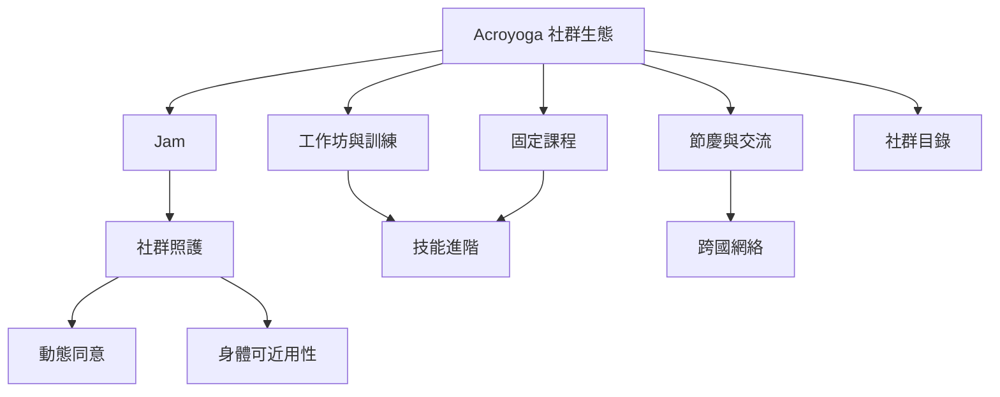

Acroyoga 社群由固定課程、非正式 jam、工作坊、師資訓練、節慶與跨國交流共同構成。地方社群目錄和活動平台可協助探索，但資料可見度不等於人口統計。Jam 的開放性需要共同規則與社群照護，才可能讓新手、不同身體條件者與不同程度的參與者持續加入。

## 概念
* [[term/Jam 是以共同練習與非正式互學為核心的社群聚會]]
* [[term/社群照護是成員共同維護安全與參與條件的實踐]]
* [[term/身體可近用性是環境與活動能否被不同身體安全使用的程度]]
* [[term/社群目錄是尋找地方團體的可更新索引而非完整人口統計]]
* [[term/社會連結是個體感受到與他人關係及歸屬的程度]]
* [[term/社會馬戲以表演與身體技藝促進社會參與和包容]]

## 永久筆記
* [[note/Jam 的開放性需要明確規則才能成為安全的共同學習空間]]
* [[note/包容性不是開放報名而是提供多種有效參與角色]]
* [[note/全球社群目錄是探索入口而不是普查統計]]
* [[note/正式師資訓練與開放式 Jam 應形成互補而非彼此取代]]

## 文獻
* [[data/AcroLove 社群目錄呈現六大區域的社群分布]]
* [[data/AcroWorld 2026–2027 活動清單顯示歐洲與跨洲節慶網絡]]
* [[data/AcroYoga Jam 社群規則強調三角色的共同安全責任]]
* [[data/社會馬戲系統性回顧發現包容效果正向但證據仍有限]]
