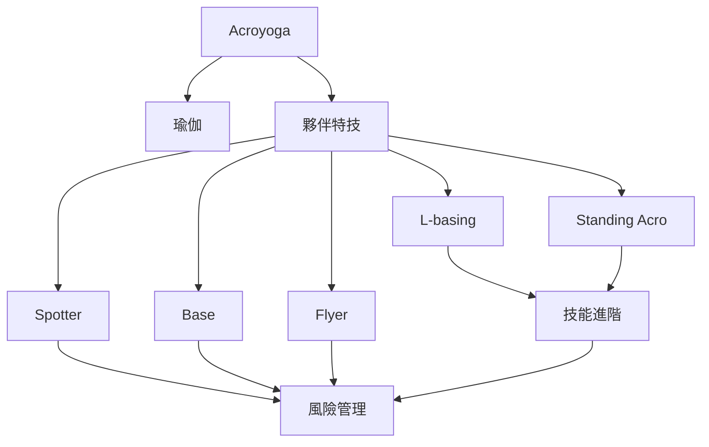

本圖把 Acroyoga 的核心構件放在一起：瑜伽提供身體覺察與呼吸練習，夥伴特技提供支撐和平衡任務，base、flyer、spotter 共同構成安全系統。L-basing 與 standing acro 是不同支撐情境，技能進階與風險管理則貫穿兩者。

## 概念
* [[term/Acroyoga 是結合瑜伽意識與夥伴特技的身體實踐]]
* [[term/瑜伽是結合身體練習與心智訓練的多元傳統]]
* [[term/夥伴特技是兩人或多人以支撐與動作協作完成技巧]]
* [[term/Base 是提供穩定支撐並主動溝通的 Acroyoga 角色]]
* [[term/Flyer 是在空中維持身體張力與空間覺察的 Acroyoga 角色]]
* [[term/Spotter 是協助監測風險與控制墜落的 Acroyoga 角色]]
* [[term/L-basing 是以地面仰躺支撐為核心的飛行方式]]
* [[term/Standing Acro 是以站立支撐與動態平衡為主的特技形式]]
* [[term/技能進階是以能力與可控性為依據逐層增加任務難度]]
* [[term/風險管理是辨識危害並降低暴露與後果的系統方法]]

## 永久筆記
* [[note/三角色不是固定階級而是互相依賴的安全系統]]
* [[note/Spotter 是一項需要專門能力的安全工作而非旁觀者角色]]
* [[note/動作進階應以可重複控制而非一次成功作為標準]]
* [[note/安全不是勇氣的反面而是練習設計的一部分]]

## 文獻
* [[data/Masaryk 大學教材把 Acroyoga 描述為三角色合作的體驗式學習]]
* [[data/AcroYoga Austin 將 Spotting 視為需要專門訓練的技術]]
* [[data/美國骨科醫學會安全指南強調熱身裝備與監督]]
