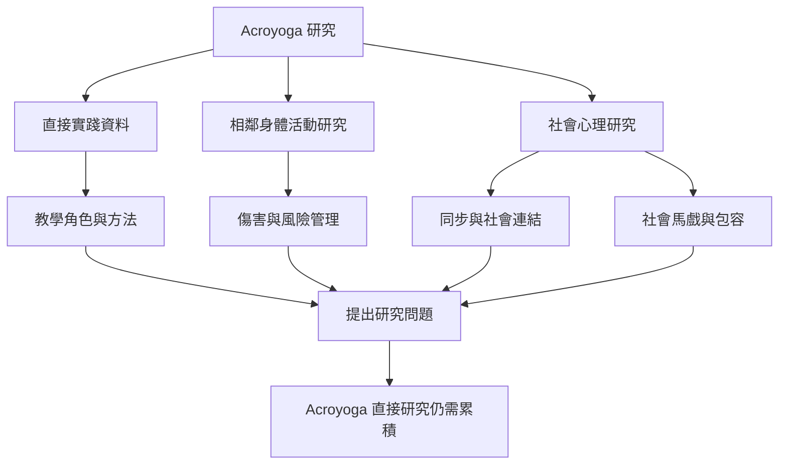

現有可用研究需要分層閱讀：Acroyoga 的官方教材與社群資料能說明實踐者怎麼教、怎麼練；體操研究能提供相鄰的傷害風險原則；舞蹈同步研究和社會馬戲回顧則能提出社會連結與包容的假說。它們都不能取代直接針對 Acroyoga 的臨床或長期社會效果研究。

## 概念
* [[term/風險管理是辨識危害並降低暴露與後果的系統方法]]
* [[term/人際同步是互動者在時間或動作上的相互協調]]
* [[term/社會連結是個體感受到與他人關係及歸屬的程度]]
* [[term/社會馬戲以表演與身體技藝促進社會參與和包容]]
* [[term/身體可近用性是環境與活動能否被不同身體安全使用的程度]]

## 永久筆記
* [[note/Acroyoga 的健康效益應區分合理機制與直接證據]]
* [[note/同步動作研究可提出假說但不能直接證明 Acroyoga 的療效]]
* [[note/安全不是勇氣的反面而是練習設計的一部分]]
* [[note/包容性不是開放報名而是提供多種有效參與角色]]

## 文獻
* [[data/競技體操傷害系統性回顧指出訓練暴露與競技程度值得監測]]
* [[data/美國骨科醫學會安全指南強調熱身裝備與監督]]
* [[data/舞蹈同步研究發現同步活動可提升主觀社會連結]]
* [[data/跨群體同步研究指出共同動作可能提升群際連結]]
* [[data/人際同步整合性回顧提出六個分析維度]]
* [[data/社會馬戲系統性回顧發現包容效果正向但證據仍有限]]
