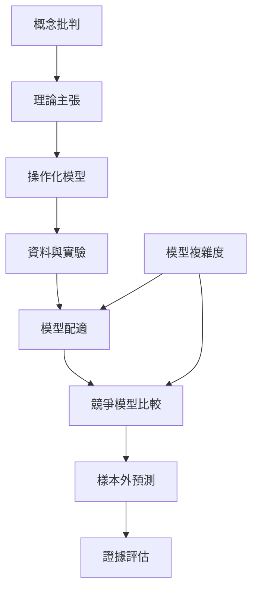

主動推論的研究價值不應只由其統一性或數學優雅程度判斷。需要區分形式框架、具體模型與經驗主張；模型擬合資料不等於理論獲得驗證。合理的實證路徑包括模型比較、樣本外預測、參數恢復、實驗操弄及神經機制驗證。

## Mermaid 關係圖

## 雙向連結
* 理論筆記：[[主動推論需要區分數學原理與實證理論]]、[[主動推論模型必須與競爭模型比較]]、[[模型配適不等於理論已獲證明]]、[[數學邊界不自動等於自然界的物理邊界]]
* 概念：[[模型比較]]、[[模型證據]]、[[變分自由能]]、[[馬可夫毯]]
* 文獻：[[2024 年回顧指出主動推論的經驗驗證仍需更嚴格的模型比較]]、[[馬可夫毯的統計用途不能直接等同於心智與身體的物理邊界]]、[[自由能原理作為數學模型與作為經驗理論必須分開評估]]

* 延伸：[[替知識庫建立主張強度與證據層級標籤]]、[[為每個主動推論案例建立競爭解釋欄位]]
