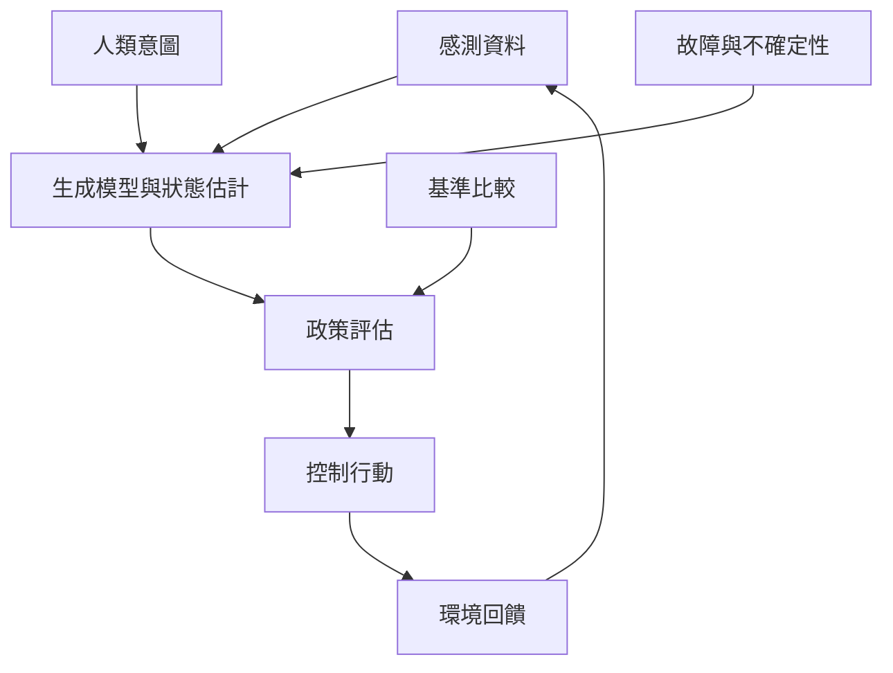

工程應用將主動推論視為整合狀態估計、控制、規劃及學習的候選架構。機器人與人機互動特別適合研究不確定感測、意圖預測與適應性行動，但研究成熟度仍不均。必須在同等任務和運算條件下，與傳統控制、模型預測控制及強化學習比較。

## Mermaid 關係圖

## 雙向連結
* 理論筆記：[[主動推論把狀態估計規劃與控制整合在生成模型中]]、[[工程應用需要與成熟基準公平比較]]
* 概念：[[部分可觀測馬可夫決策過程]]、[[政策]]、[[強化學習]]、[[多代理者系統]]
* 文獻：[[機器人研究把主動推論當作整合感知控制與學習的候選框架]]、[[人機協作的意圖推斷研究提供主動推論可比較的鄰近方法]]、[[2026 年工程教材將主動推論帶入工程與機器學習讀者]]、[[日本慶應團隊展示深度主動推論控制真實機器人]]、[[日本沖繩研究單位把主動推論延伸到神經機器人與社會互動]]、[[神經機器人研究以共享世界探索自我與主體性]]

* 延伸：[[為每個主動推論案例建立競爭解釋欄位]]、[[建立一份跨文化主動推論研究地圖]]
