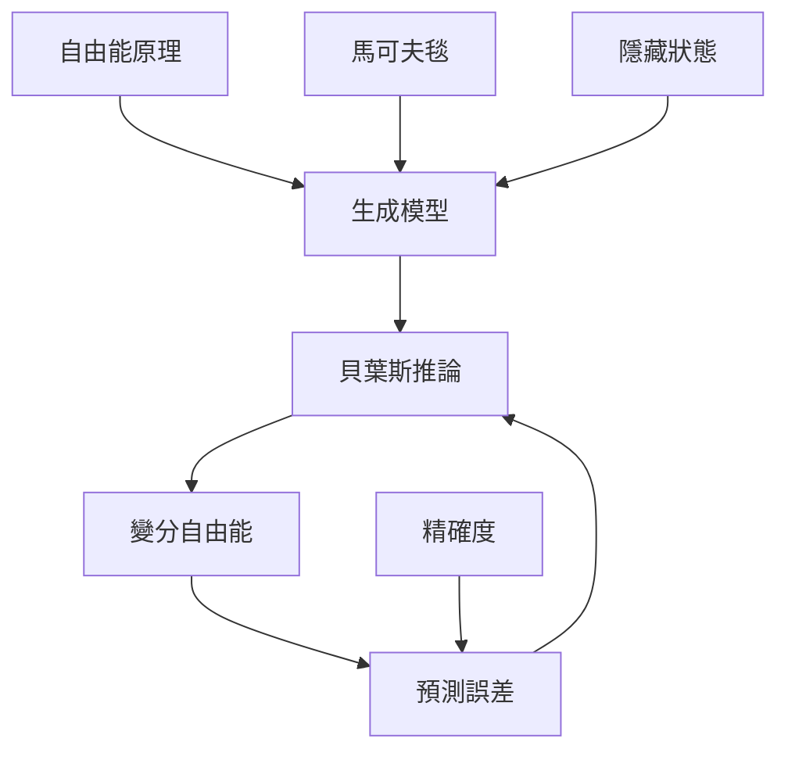

這張圖整理主動推論的理論地基：代理者以生成模型描述隱藏狀態與觀測的關係，透過貝葉斯推論更新信念，並以變分自由能處理模型與資料的落差。馬可夫毯則提供一種條件獨立結構，但其數學用途不能直接推成物理邊界。

## Mermaid 關係圖

## 雙向連結
* 理論筆記：[[主動推論把知覺行動與學習理解為同一循環]]、[[生成模型讓知覺成為對隱藏原因的推論]]、[[變分自由能以可計算量近似難以直接衡量的驚訝度]]、[[預測誤差促使信念更新]]、[[精確度決定不同訊號的相對權重]]
* 概念：[[主動推論]]、[[自由能原理]]、[[生成模型]]、[[變分自由能]]、[[馬可夫毯]]、[[貝葉斯推論]]、[[隱藏狀態]]、[[條件獨立]]
* 文獻：[[自由能原理提出以感覺預測解釋生物系統的持續存在]]、[[自由能框架提供理解知覺與學習的數學入門]]

* 延伸：[[替知識庫建立主張強度與證據層級標籤]]、[[建立一份跨文化主動推論研究地圖]]
