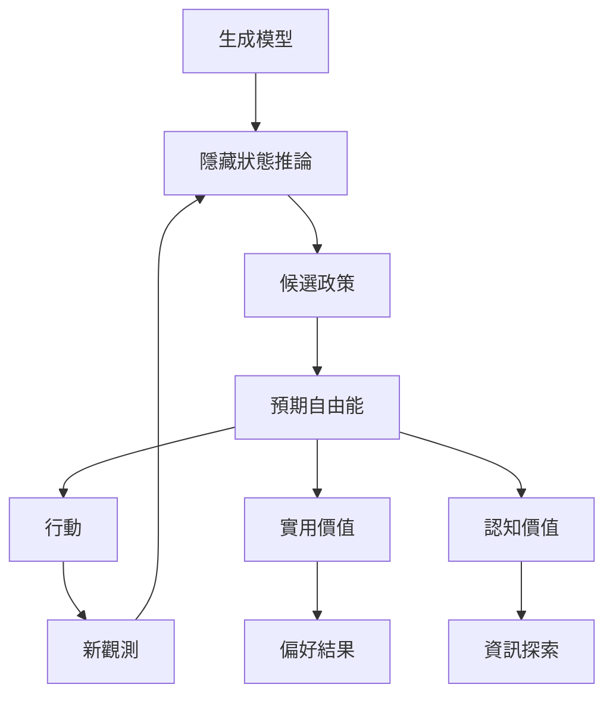

主動推論不把知覺、行動與學習視為彼此獨立的模組，而是以循環方式處理：代理者推斷狀態，評估政策，行動取得新的觀測，再更新模型。預期自由能把實用價值與認知價值放進同一評估架構，讓探索與利用可以相互權衡。

## Mermaid 關係圖

## 雙向連結
* 理論筆記：[[行動能主動改變代理者接收的感覺資料]]、[[預期自由能整合目標追求與資訊探索]]、[[政策是通往預期狀態的行動序列]]、[[探索與利用不是必然互斥的兩種模式]]
* 概念：[[預期自由能]]、[[政策]]、[[認知價值]]、[[實用價值]]、[[探索與利用權衡]]、[[部分可觀測馬可夫決策過程]]
* 文獻：[[離散狀態空間綜述整理主動推論的模型結構與研究挑戰]]、[[主動推論與強化學習有相似處但優化目標並不相同]]

* 延伸：[[把每日選擇記錄成偏好與資訊探索的雙重路徑]]、[[把感官步行設計成主動取樣而非單純移動]]
