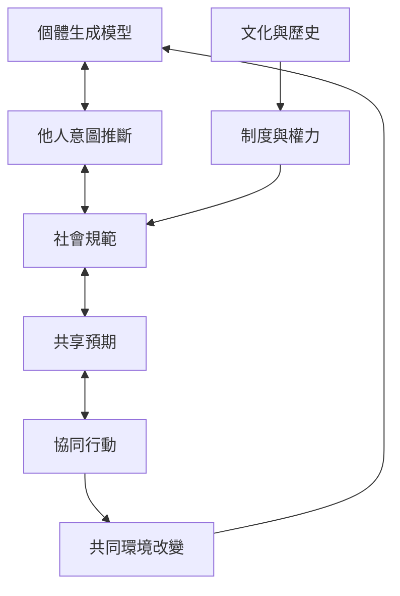

主動推論可以描述人們如何推斷他人意圖、學習規範與協調共同活動。共享預期能降低互動中的不確定性，但社會世界也由制度、權力、歷史與物質環境塑造，不能只被還原成個體腦中的先驗。生態取向進一步提醒，溝通不只是傳送訊息，也會改變共同的行動環境。

## Mermaid 關係圖

## 雙向連結
* 理論筆記：[[社會規範會成為行動者對他人反應的預期]]、[[共享生成模型能協調多個行動者]]、[[文化不能只被還原成個體腦中的先驗]]
* 概念：[[社會認知]]、[[多代理者系統]]、[[可供性]]、[[現象學]]
* 文獻：[[社會規範可被建模為人們對情境與他人行為的共享預期]]、[[合作溝通可以從共同調節互動來理解而非只看訊息對齊]]

* 延伸：[[把共享餐桌視為多代理者協調的微型場域]]、[[把非暴力溝通和主動推論放在不同層次互相補充]]、[[讓小型社群用低成本方式測試共同預期]]
