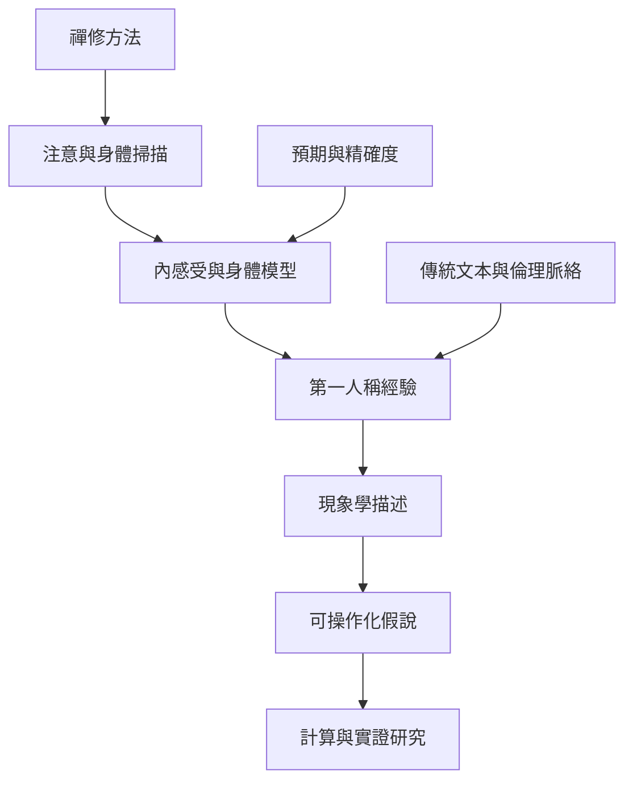

禪修研究可將第一人稱經驗、身體感受、注意調節與計算模型並置。2026 年研究提出以預測處理或主動推論理解身體邊界消融與深度禪修去建構，但目前應視為新興假說。模型術語不應取代修行者描述、傳統脈絡與倫理意義。

## Mermaid 關係圖

## 雙向連結
* 理論筆記：[[禪修第一人稱經驗不能被理論術語取代]]、[[平等心可作為非反應性觀察的研究問題]]
* 概念：[[現象學]]、[[內感受]]、[[平等心]]、[[注意力]]、[[預測處理]]
* 文獻：[[2026 年冥想研究提出以主動推論解釋深度禪修的假說]]、[[身體掃描與身體邊界消融是預測處理研究的新興議題]]、[[Friston 訪談把自由能原理連結不確定性壓力與生命]]、[[Friston 訪談呈現主動推論對意識自由意志與 AI 的擴張性觀點]]

* 延伸：[[將禪修現象學與計算模型並置而不互相吞併]]、[[用身體掃描研究注意與預測如何互相影響]]、[[以平等心觀察預測落差而非急著消除不舒服]]
