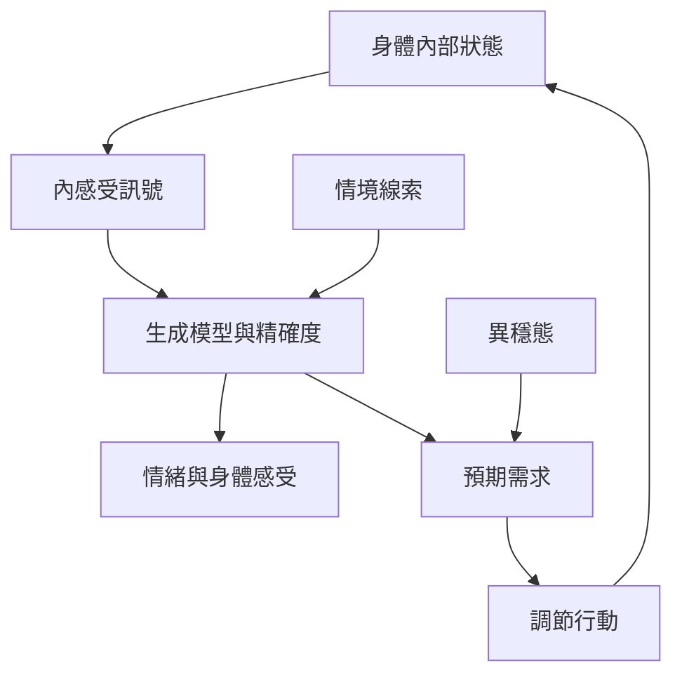

身體訊號不是認知之外的背景，而可能參與情緒、動機與行動選擇。內感受研究關注身體內部訊號如何被感知和整合；異穩態強調預測性生理調節。主動推論可提供身體預測與行動調節的計算語言，但情緒與生理機制需要多種測量互相驗證。

## Mermaid 關係圖

## 雙向連結
* 理論筆記：[[內感受是對身體內部狀態的感知]]、[[異穩態是依預測調節身體需求的過程]]、[[情緒經驗涉及身體訊號與情境解讀]]
* 概念：[[內感受]]、[[異穩態]]、[[注意力]]、[[精確度]]
* 文獻：[[內感受研究指出情緒與身體訊號的整合機制仍待釐清]]、[[內感受技術有臨床潛力但量測與轉譯尚未標準化]]

* 延伸：[[用身體掃描研究注意與預測如何互相影響]]、[[以平等心觀察預測落差而非急著消除不舒服]]
