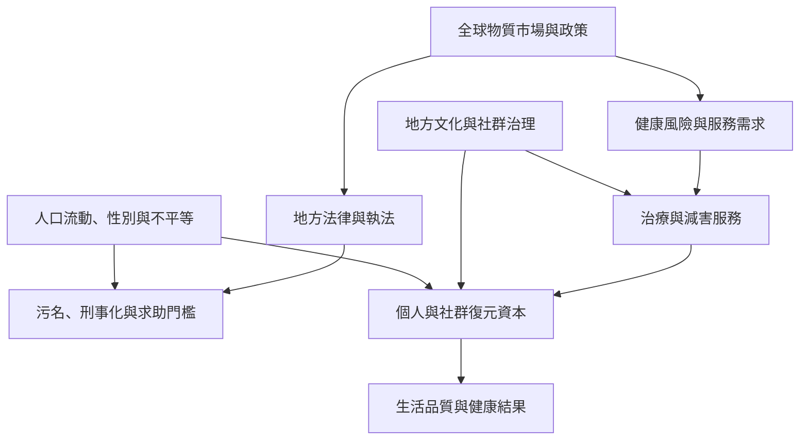

成癮與復元的全球經驗具有共同面向，也受到地方歷史、法律、經濟、醫療供應、殖民關係、家庭制度與文化實踐影響。跨國比較必須保留脈絡，不把某一國家的政策或療法當成普遍配方。

可比較 UNODC 全球市場與治療資料、比利時移民復元訪談、加拿大第一民族經驗、坦尚尼亞污名研究、全球南方青年減害倡議，以及葡萄牙與冰島政策案例。

## 思與行
* 比較不同地區時，先確認資料年份與定義，再比較數字。
* 把當事人的敘事與官方統計並讀，避免只見政策數字而忽略制度如何被經驗。
* 連結[[全球毒品政策]]、[[社會決定因素]]、[[文化回應式照護能增加復元資源的可用性]]及[[復元資本]]。

## 參考
* [[2025年世界毒品報告指出藥物市場變化必須與脆弱處境及公共衛生一起理解]]。
* [[聯合國毒品報告顯示亞洲治療覆蓋率與性別落差值得注意]]。
* [[移民與少數族裔復元訪談顯示文化與社會網絡形塑復元資本]]。
* [[加拿大第一民族復元研究指出土地文化與持續照護的重要性]]。
* [[坦尚尼亞訪談顯示污名會在交通職場家庭與診療機構中阻礙阿片治療]]。
* [[全球南方青年倡議者將減害與社群主導視為權利議題]]。
* [[葡萄牙去刑事化經驗必須連同制度執行與支持服務評估]]。
* [[冰島青少年預防模式的成功敘事仍需檢驗可移植性]]。

回到[[Addiction]]。
