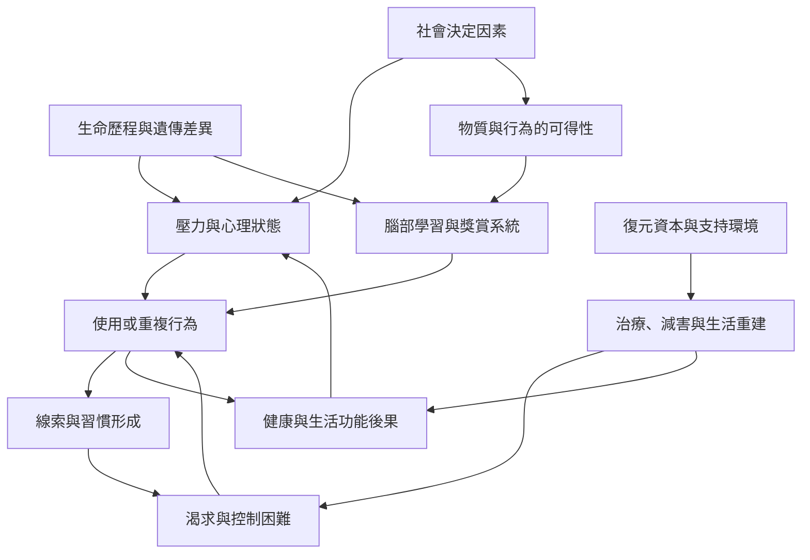

成癮不宜被理解為一條線性的因果鏈。不同人的風險、使用功能、維持機制與復元資源各有差異；神經學習與生命條件會互相影響。

這張圖是概念整理，不是每個人都必然經歷的固定流程。成癮可由不同入口開始，也可能在支持、環境改變與治療下走向不同結果。

可從[[成癮]]、[[物質使用障礙]]、[[渴求]]、[[線索]]、[[激勵顯著性]]、[[負向強化]]、[[創傷]]、[[社會決定因素]]及[[復元資本]]進入。核心論點見[[成癮是多層次交互作用的結果，而非單一意志缺陷]]。

## 參考
* 神經與行為機制：[[NIAAA以三階段循環說明酒精成癮與復元中的腦部變化]]、[[激勵敏化理論指出想要不等於喜歡]]。
* 系統脈絡：[[ASAM將成癮描述為腦部生命經驗與環境互動的可治療疾病]]。

回到[[Addiction]]。
