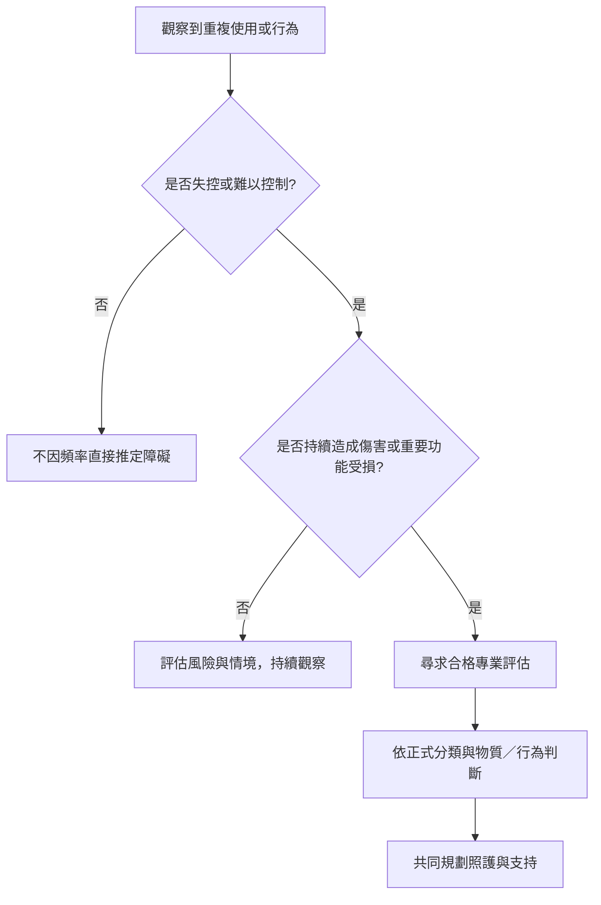

診斷的功能是識別需要照護的痛苦與功能損害，而不是替所有投入或重複行為貼上病名。正式診斷、風險使用與日常語言中的「上癮」必須分清楚。

圖中只是理解流程，不是自我診斷工具。酒精使用障礙的 DSM-5-TR 準則與 ICD-11 的行為障礙分類，不能任意互換。

可連結[[診斷重點是失控與功能受損而非單純使用頻率]]、[[物質使用障礙]]、[[行為成癮]]、[[賭博障礙]]與[[遊戲障礙]]。

## 參考
* [[NIAAA指出酒精使用障礙以症狀與功能影響分級]]。
* [[WHO將賭博與遊戲障礙列為成癮行為相關診斷]]。

回到[[Addiction]]。
